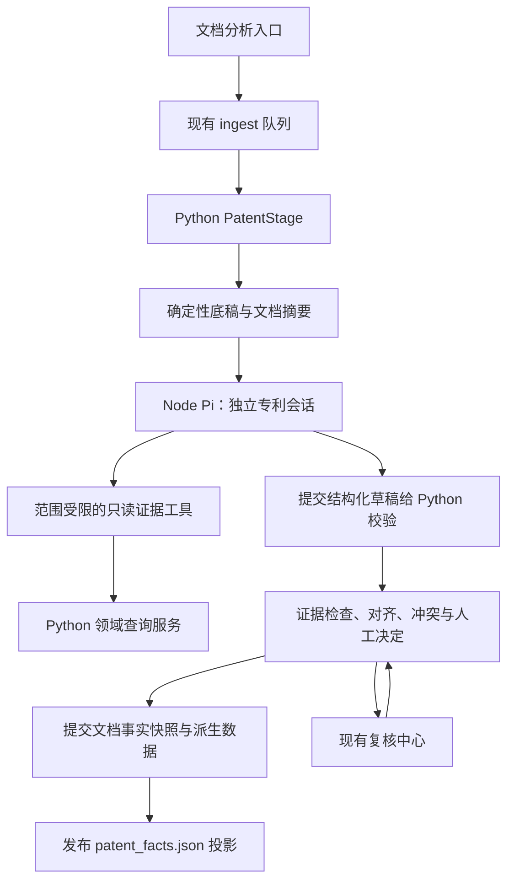

# Patent 分析改造与领域 Agent Harness 修改计划

状态：本轮前端 U0/U1/P4 改造及必要接口联调已完成；P0–P3 已落地。2026-10-30 完成一个真实表格的 harness/provider/候选发布核对；P5 的多文档科学评估仍待执行，未默认启用 LLM 专利分析。
日期：2026-10-13。  
首版目标：以 LLM 交互为主入口重组研究工作台，复用现有 Pi 运行时完成证据约束的专利分析，使任务可继续、结果可核查、冲突可修正、重跑不丢失人工决定。

2026-10-30 当前实现以 [harness 验证记录](qa/patent-harness-20261030.md) 为准：
按 gap 下发带 ID 的 work/context 证据包，提交工具直接使用导出的 PatentGapAnswer
JSON Schema，删除提示词中的第二份 schema 描述。表格逐条提交 source_quote，
校验原文读数、比较符和指标的字面支持；上下文引用不改变 work 锚点，Example
与 Compound 保留不同命名空间。真实样本提取 22 条待复核读数和 3 个方法，
未完成结构关联，也未证明泛化能力。下文 2026-10-13 实施记录保留为历史。

## 1. 设计结论与范围

保留 MBForge 的 Python 领域服务、SQLite、文档产物、队列和 React 工作台；将现有 Node Pi 侧车从聊天入口扩展为同时承载聊天和专利分析的运行时。Python 控制事实校验、复核和发布，Node 控制模型调用、上下文和工具循环。

2026-10-13 范围修订：前端需要单独进行一轮以 LLM 交互为主的信息架构、任务流和页面设计。此前“只在现有页面补状态、暂缓重做导航”的范围已被替换。重组应用外壳和主要交互，复用已有 PDF、分子、表格、复核与对接视图以及 UI 组件；不把全部操作变成聊天文本。

首版使用 Pi 0.73.1 完成。2026-10-13 按后续“优化提示词、接入 Tavily、优先复用 Pi 插件及升级 Pi”的需求，迁移到新官方包名 `@earendil-works/pi-coding-agent` / `pi-ai` 并锁定 1.2.0；当前实施依据该版本的 SDK 声明。继续不引入 LangGraph、Deep Agents、新的 Python provider 客户端或另一套自写 Agent 循环。

### 首版交付

- 保留单个 PatentStage：确定性底稿 → LLM 分析 → 校验与冲突处理 → 发布；LLM 不可用时明确回退。
- LLM 优先补充正文测定方法、正文活性记录、化合物与测定关联；规则继续提供章节、条目、结构与标签底稿。
- 独立的专利任务会话、工具集合、运行预算、取消和进度记录。
- 可操作的冲突复核：选定候选值或拒绝两者，决定写入有效结果，并在重跑时保留。
- 用人工核对样本评价正确率、遗漏与错误关联；先完成一个可信的纵向流程。
- 新的默认研究工作台：研究任务/会话导航、主对话、任务状态、上下文选择和按需展开的结果/证据工作区。
- 持久化研究会话与任务/产物引用；刷新页面后可重新查看历史和运行状态。

### 暂缓

- LLM 接管所有章节和条目、合成步骤提取、开放式自主研究、多 Agent 委派。
- 知识图谱、通用插件系统或 MCP 平台；研究任务导航纳入本轮，但不另建一套后台调度系统。
- 跨模型自动切换、通用工作流引擎、Agent 循环断点恢复。
- SAR、分子生成、实验管理的实际功能开发；本计划只定义未来接入边界。

## 2. 已核对的现状

| 项目 | 当前状态与入口 | 本次处理 |
| --- | --- | --- |
| 环境 | `.venv` Python 3.12.13；Node 24.19.0；uv 管理 Python | 沿用，不重建环境 |
| 流水线 | Extract → Markdown → Patent；导入只运行前两者，Patent 按需排队 | 保留入口、阶段名和取消语义 |
| Patent | `service/pipeline/stages/patent_stage.py` 读取 SQL 证据、关联事实、持久化候选并发布 | 增加分析分支，复用确定性实现 |
| Agent | `agent/src/server.ts` 提供聊天、模型列表和探测；会话使用内存 | 增加独立的有界分析入口 |
| 工具 | `api/http/agent.py` 的现有工具通过 `resolve_library_root(None)` 查询当前资料库 | 后台分析另用任务绑定的范围，复用查询用例而非照搬范围解析 |
| 进度 | `service/pipeline/runner.py` 创建 `PipelineEventSink`；`run/context.py` 尚无阶段内进度字段 | 复用事件链，补齐阶段内进度 |
| 产物 | `service/pipeline/patent/artifact.py` 定义 `patent_facts.json`；集合内多数事实仍为 dict | 新输入使用严格类型，发布复用既有字段 |
| 复核 | `service/use_cases/review_queue.py` 的通用决定主要更新状态 | 新类型必须有领域副作用 |
| 测量 provenance | 已存放化合物引用信息 | 扩展，禁止覆盖原字段 |

现状依据见 [TODO 索引](../TODO/INDEX.md)、[架构](wiki/architecture.md)和[流水线契约](wiki/pipeline.md)。执行前复核变更区域和调用方；当前 README、TODO 索引已有本轮之前的修改，不能覆盖或重置。

## 3. 职责和调用关系



- **Node**：唯一 provider 调用方；复用配置、模型适配和 Pi 循环；管理专利会话、预算、工具执行与运行事件。
- **Python service/domain**：定义事实语义、来源约束、结构校验、关联条件、冲突策略和发布用例；通过端口使用运行时和存储。
- **Python server**：实现侧车传输适配器、任务范围注册和进程治理；在 `server/app.py` 装配。
- **db**：实现事实发布状态、人工决定和现有派生数据的事务，不向上导入 service。
- **api**：严格验证请求，调用用例；不写 SQL、不承载模型循环。
- **frontend**：以研究对话为主入口，将任务、证据、结构化结果和复核嵌入同一工作台；复用 `components/ui` 和现有专业视图。

聊天与分析共享运行代码和模型配置，使用不同会话。专利会话不继承聊天记录、`library_sql`、对接、文件写入或 shell 工具。

前台研究会话引用后台任务，不直接复用后台专利会话。用户继续聊天、查看证据或切换任务，不会改变后台任务已绑定的输入；也不要求把后台每次工具返回全文写进聊天记录。

## 4. 首版契约

### 4.1 任务范围与传输

新增窄接口 `PatentAnalysisRuntime`，只暴露本次分析需要的执行和取消能力；不设计通用任务平台。跨层契约放 `mbforge/contracts/`，端口放 `mbforge/ports/`，实际文件名以这些职责为准。

运行请求包含：协议版本、`doc_id`、`run_id`、`attempt_id`、证据签名、确定性摘要、预算。资料库绝对路径由 Python 绑定，不能由模型传入或修改。每个任务绑定一次不可变的 `{library_root, doc_id, run_id, attempt_id, evidence_signature}`。

建议增加侧车内部 `POST /v1/patent-analysis` 事件流入口及对应取消入口。它独立于 `/v1/chat`，返回进度、工具结果状态、草稿提交和终态；终态必须且只能有一个。传输断开不能当作成功。

Python 在运行期间注册短期任务凭据，Node 的工具回调携带凭据；服务端根据凭据查绑定范围，不接受模型提供的路径、其他文档 ID、provider 密钥或任意 URL。凭据不进入模型上下文、不写日志，结束即失效。迟到结果必须同时匹配 attempt 和证据签名才可采用。

`PatentStage` 在队列执行线程中等待侧车，FastAPI 事件循环继续处理工具回调。不得在事件循环或持有 SQL 事务、文档发布锁时等待 LLM。

### 4.2 分析工具

| 工具 | 输入与结果 | 限制 |
| --- | --- | --- |
| `read_evidence` | evidence IDs 或页码范围；返回原文、页码、bbox、ID | 只读绑定文档；限制数量与输出长度 |
| `search_evidence` | 文本查询、分页；返回证据定位 | 不接受 SQL；返回截断标志和下一页信息 |
| `list_molecules` | 分页；返回既有识别结构、标签和证据引用 | 不创建结构，不能查其他资料库 |
| `get_deterministic_draft` | 按类别读取规则底稿 | 底稿标为待核查机器结果 |
| `submit_facts` | 严格结构化草稿；返回校验结果 | 只校验和暂存本次候选，不直接发布或修改业务数据 |

首版不让模型生成或修正 SMILES；关联必须指向既有检测候选或已确认分子。结构有效性校验留在 Python 发布边界。

摘要包含章节索引、测定和表格线索、候选结构索引、规则事实数量及覆盖范围。正文按证据下钻；不能只截取前若干字符而不报告遗漏页码。最终草稿需包含已查看和未覆盖的范围，未覆盖部分不得标为已验证。

### 4.3 输出与来源约束

Python Pydantic 模型是草稿契约的权威定义：`extra="forbid"`、有界集合、显式可空字段和枚举。Node 使用导出的版本化 JSON Schema，避免手工维护第二份事实字段定义；新增依赖不是默认选项。

首版草稿只包含测定方法、测量和关联建议。每项携带证据引用、原始表达和定位；关联引用草稿内局部键，最终业务 ID 由 Python 计算。

测量至少保留：化合物引用、靶点与物种、测定/endpoint、metric、原始值、比较符、单位、条件、缺失字段和来源位置。不可把 `<100 nM` 写成精确的 `100 nM`，不可将固定浓度抑制率当作 IC50，不可把 human MRGPRX2 与 mouse Mrgprb2 合并。

校验分三层：

1. 结构与引用：schema 合法；所有 evidence ID 属于绑定文档；局部引用存在；结构来自可接受的既有候选。
2. 字段支撑：原始值、比较符、单位能定位到原文或表格单元；复用既有 normalization；表头、行标签、脚注的证据共同保留。
3. 语义与关联：靶点、物种、测定条件和化合物关系是否明确。不能确定时保留候选并进入复核，不能仅凭引用存在放行。

第一层不合法的事实不进入有效结果；第二、三层不能证明的事实只能进入待复核集合。原文字符串匹配和规则校验不宣称能证明全部语义正确。

已有 `provenance.reference_raw/reference_key` 等内容保留；新增提取来源、prompt 版本、模型、支持检查结果和复核状态。LLM 自报信心如保存，应命名为 `model_confidence`，不用于自动通过门槛。

### 4.4 对齐、冲突与事实状态

将事实来源与可用状态分开：来源为 `deterministic/llm/agreed/human`；状态为 `accepted/pending_review/rejected`。`accepted` 表示满足系统采用规则，不等于实验真实性已被独立证明。

- 先按文档、来源锚点、化合物、测定、metric 和条件对齐，再比较字段值；**value 和 LLM 改写后的标题不能成为匹配主键**。
- 同一化合物不同 assay、重复测定和同页多个记录不能压成一条；无法唯一对齐时报告歧义。
- 双方一致但缺少支撑，仍待复核；一致只说明解析结果一致。
- LLM-only 且通过采用规则，可补入有效结果；确定性-only 保留现状，但被本次冲突质疑的记录暂缓采用。
- 同一事实槽位存在不兼容值：保留两者，创建一个冲突项；冲突槽位的两种值均不进入下游可用结果。
- 人工选择优先于再次提取，但只在证据签名和冲突候选签名仍匹配时复用；签名变化则失效并重新复核。

区分“来源事实槽位 ID”与“候选内容签名”：槽位根据稳定来源锚点生成，内容签名包含待比较字段。复核项 ID 用槽位加候选集合签名生成，重复运行不重复建项，也不会误用旧决定。

### 4.5 持久化与发布的一致性

为完成复核和重跑闭环，新增**一个文档级分析状态表** `patent_analysis_state`，保存当前 revision、证据签名、有效产物 payload、人工决定映射及更新时间。事实 payload 和决定映射都必须经严格契约校验；实际列定义在阶段 P0 固定。不额外建设通用事实数据库。

明确权威关系：SQL 中该表是已提交 Patent 分析快照和人工决定的权威状态；`patent_facts.json` 保留现有路径和接口，成为可重建的文件投影。SQL `SourceEvidence` 仍是唯一原始证据源，模型对话不成为证据。这是对旧“文件为唯一事实源”提案的有意调整，避免文件和 SQL 被独立编辑。

发布流程：

1. 全部计算与验证在事务外完成；生成新的 artifact payload 和派生候选。
2. db 内一个事务检查 expected revision、attempt、当前证据签名；提交分析快照、人工决定和允许持久化的派生结果。复用既有候选过滤，重构事务接缝时保留校验。
3. SQL 提交后，以临时文件加原子替换刷新 `patent_facts.json`。文件带 revision；文件写失败要明确记录投影失败，不能报告完整发布成功。
4. `service/use_cases/documents/patent_facts.py` 优先读取已提交快照；旧文档无状态行时沿用旧 artifact。读请求、重试或恢复可以按已提交 payload 修复落后的文件，不再调用模型。

SQL 事务与文件替换不宣称跨介质原子。SQL 提交后文件写失败，重试只修复投影，不重复派生持久化；消费者通过同一读用例获得一致 revision。

已有无法关联结构的测量仍保留在产物，不伪造 `activities.mol_id`。待复核、拒绝或关联不明确的新增事实不进入可用于 SAR 的派生数据。修复后的发布必须删除/替换该文档已过期的派生结果，包括新结果为空的情况，不能留下旧活性。

删除文档同步删除分析状态；清空复核队列不删除该表的人工决定。重新 Extract 后证据签名变化，旧快照标为过期、旧决定停止自动应用；不得静默展示为本轮有效结果。涉及这些操作的调用方必须在 P0 纳入修改清单。

### 4.6 预算、取消和回退

初始工程上限：24 个模型轮次、600 秒墙钟、80,000 个累计输入/输出 token、60,000 字符初始摘要；不是科学验收阈值。存为小型 `patent_analysis` 配置，首版默认 `enabled=false`，完成验收后再决定默认启用。专利分析并发先限制为 1，不复用 ingest 最大并发作为 provider 限额。

单次 provider 超时和重试总时间不得超过剩余墙钟预算；在下一次调用前检查累计 token，并记录最后一次调用可能产生的超限。provider 不提供完整 usage 时记为未知，不记成 0；输入与单次输出仍设界限，未知用量时靠轮次和时间限制。

只有结构提交失败可将校验错误反馈给模型修复一次，计入同一预算；不能在 Python、Node、SDK 三层叠加重试。

| 情形 | 行为 |
| --- | --- |
| 功能关闭 | 确定性路径，`extraction_mode=deterministic` |
| 未配置、侧车不就绪、provider/预算/草稿错误 | 停止本次分析并回退，记录原因；保护已有人工决定与有效结果 |
| 用户取消 | 传播 `TaskCancelledError`，中止侧车和在途工具；不回退、不发布 |
| SQL 证据缺失、数据损坏、确定性提取失败 | 保持真实阶段失败，不能用“回退”掩盖 |
| 复核/发布失败 | 报告失败或投影待修复，不能再以确定性覆盖已提交结果 |

LLM 异常捕获仅包围分析和草稿校验边界。回退也经过同一决定应用和发布用例；已有采用的 LLM-only 事实不能因为一次断网被静默清除，保留并标记本轮未重验，直到明确的新分析或人工修正。

区分 `analysis_status`（disabled/succeeded/fallback）与 `extraction_mode`（deterministic/hybrid）。完整合并含规则补充时不能标成纯 LLM。取消和错误沿用任务终态，待复核数量另行展示。

## 5. 实施阶段与交付

以下时间是单人有效工作日估算，加入主界面改造后合计约 15–24 日；不含等待真实 provider、人工标注或外部模型服务修复。每阶段完成后更新复选框并记录实际验证结果，不以代码存在代替验收。U0 应先完成以固定交互契约，后续领域逻辑与 UI 可按契约交替推进，不先重写全部前端。

| 阶段 | 状态 | 工作量 | 依赖 | 输出与退出条件 |
| --- | --- | --- | --- | --- |
| 现状与范围 | 已完成 | 本轮完成 | 无 | 本计划；代码入口与风险已核对 |
| U0 工作台信息架构与原型 | 已完成（前端首版） | 1–2 日 | 本计划 | 对话主入口、资源工作区、输入上下文、历史与任务入口已落地 |
| P0 契约与采用规则 | 已完成 | 1–2 日 | 本计划 | 严格类型、状态表字段、匹配/失效规则、影响清单固定；离线样本覆盖关键边界 |
| P1 Pi 分析运行时 | 已完成（运行时与前端启动协作） | 2–3 日 | P0 | 独立入口、范围绑定、有限工具、预算、取消和进度；开发启动由 dev:all 管理，Vite 不创建/终止共享 Agent |
| P2 校验与合并 | 已完成 | 2–3 日 | P0、P1 | 正文事实草稿可校验；对齐与冲突正确；保留比较符、单位和已有 provenance |
| P3 发布与复核闭环 | 已完成（后端；复核 UI 归前端） | 2–3 日 | P2 | SQL 快照、派生数据、文件投影一致；复核生效；重跑保留决定；失败可恢复 |
| U1 研究会话与任务桥接 | 已完成（SQL、Pi 恢复与联调） | 2–3 日 | U0、P0、P1 | SQL 可见历史、Pi 会话文件、受约束任务工具与结构化任务/产物引用已接通 |
| P4 LLM 主工作台实施 | 已完成（前端与接口联调） | 4–6 日 | U0、U1、P1–P3 | 新外壳、全部上下文、任务/产物卡、事实表、覆盖与投影状态、跨页来源及复核闭环已接通 |
| P5 评估与文档 | 前端验收及文档完成；科学评估待做 | 1–2 日 | P4、标注样本 | 对照报告、真实流程检查、契约文档同步；决定是否启用 |

### U0：先设计完整任务流

- [x] 盘点 `App.tsx`、`AppShell`、`Sidebar`、`AgentChat`、文档 tabs、Workspace 和各专业页面；区分导航入口、可嵌入内容和独立操作。
- [x] 基于第 9 节做页面原型，覆盖空资料库、未配置模型、选文档、运行、回退、待复核、错误和恢复历史；不只画理想的聊天首页。
- [x] 固定上下文选择、任务卡、产物引用、来源跳转、停止回答/取消任务的交互契约。
- [x] 先审计 `components/ui` 和设计 token；形成复用/组合清单，再决定必要的新组件。

### P0：固定领域和发布契约

- [x] 盘点 Patent 事实的所有读方、写方、候选持久化、文档删除、流水线清理和复核清空调用方。
- [x] 在 `contracts` 定义草稿、候选、冲突、人工决定和分析快照类型；导出 Node 使用的 schema。
- [x] 确定上述 revision、证据/候选签名、状态表和读取旧 artifact 的规则；只改当前 canonical schema，不引入未批准的历史迁移。
- [x] 固定数值、单位、物种、测定关联和重复记录的采用规则；不实现另一套化学 normalization。

**P0 实施记录（2026-10-13）**

产物：

- `src/mbforge/contracts/patent.py`——`PatentDraft`（协议版本、`doc_id`/`attempt_id`/证据签名、局部键唯一且引用必须可解析、有界集合）、`PatentConflict`、`PatentDecision`、`PatentAnalysisSnapshot`，及 `FactSource/FactStatus/AnalysisStatus/ExtractionMode/DecisionChoice`。
- `src/mbforge/domain/patent_analysis.py`——槽位与签名：`measurement_slot_id`/`assay_method_slot_id` 只由来源锚点+化合物+assay+metric+条件构成（值不参与）；`candidate_signature`/`candidate_set_signature`/`conflict_id`＝槽位+候选集合签名；`evidence_signature` 顺序无关、对证据内容敏感。
- `db/sqlite/schema.py` 新增 `patent_analysis_state`（`doc_id` 主键、`revision >= 1`、`evidence_signature`、`analysis_status`、`extraction_mode`、`payload`、`decisions`、`updated_at`），经 `DatabaseManager.molecule_schema()` 装配；只改 canonical schema，无历史迁移。
- `src/mbforge/contracts/schema_export.py` 与 `agent/schemas/patent-analysis.v1.json`——Node 使用的版本化 JSON Schema，用 `uv run python -m mbforge.contracts.schema_export` 重新生成，漂移由测试守护。
- `docs/wiki/patent-adoption-rules.md`——采用规则固定为可引用规范（来源/状态、槽位/签名、对齐去重、数值/单位/比较符、物种、来源约束、冲突与决定）。

影响清单（P0 盘点；P2/P3 的修改点）：

| 面 | 调用方 |
| --- | --- |
| 事实写方 | `stages/patent_stage.py` → `artifacts/staging.py:publish_run` → `LibraryLayout.patent_facts_json`（临时文件 + 原子替换） |
| 事实读方 | `api/http/documents/library.py:238` → `use_cases/documents/library.py:read_patent_facts`（直接读文件）；`use_cases/documents/patent_facts.py` 的 `load_patent_facts`/`iter_published_doc_ids` 目前无调用方，P3 接管为「优先读已提交快照、旧文档回退旧 artifact」 |
| 派生持久化 | `patent_stage._persist_activity_backed_molecules` → `molecules.replace_document_candidates`（`db/molecule_store.py`）；清理面见 `DOC_SCOPED_MOLECULE_TABLES`，新表刻意不在其中 |
| 文档删除 | `api/http/documents/library.py:186` → `LibraryStore.delete_documents`（rmtree + `delete_document_molecule_data` + 行删除）——P3 需在此删除 `patent_analysis_state` |
| 流水线清理 | `LibraryStore.clear_pipeline_data` 的调用方：`api/http/documents/documents.py:67`（重新导入）与 `use_cases/pipeline/ingest.py:425`（删除队列任务）——按 §4.5 二者都不删除分析状态与人工决定 |
| 复核清空 | `api/http/review.py:83` → `review_queue.clear_all_review_queue`——保留分析状态表中的人工决定 |
| 前端读方 | `api/http/library.ts:fetchPatentFacts` → `useDocumentPatentFacts` → `PdfViewer`/`PdfSidebar`/`MoleculePatentFacts` |
| Node | 目前不读该产物；P1 起消费 `agent/schemas/patent-analysis.v1.json` |

验证结果：定向 `uv run pytest tests/unit/core/test_patent_analysis_contracts.py tests/unit/core/test_schema_patent_analysis_state.py tests/unit/core/test_database.py tests/unit/pipeline/test_patent_stage.py -q` → **41 passed**（新增 10 项）；后端全量 `uv run pytest tests/ -q` → **796 passed, 1 failed**，唯一失败是既有平台性问题 `tests/unit/test_docking_engine.py::test_udp_command_and_pose_parsing`（用 `#!/bin/sh` 文本桩当可执行文件，Windows 必然 WinError 193；已用 HEAD 干净快照复现，与本轮改动无关，建议按平台 skip 或改用可执行的桩）。`uv run ruff check` 与 `uv run ruff format --check` 在改动文件上通过。顺带修复：`db/pdf_probe.py` 原先把失败的异常对象直接传给 `logger.warning`，被保留的 LogRecord（pytest 日志捕获等）会钉住 traceback→pymupdf 未关闭句柄，Windows 上导入坏 PDF 后删除文档因此失败（`test_delete_document` 长期失败）；改为只记 `str(exc)` 后该测试恢复通过。离线样本覆盖：`< 100 nM` 保留比较符、固定浓度抑制率不写成 IC50、同化合物不同物种/assay/重复位置各自成槽、同槽两值构成冲突且候选集变化会更换复核项 ID（旧决定退役）、证据签名顺序无关且随内容变化、草稿局部引用必须可解析、表结构拒绝 `revision=0`。

### P1：复用 Pi，增加有界任务运行

- [x] 从现有 `createSession` 提取必要的模型/运行配置复用点，保留聊天行为；专利工具和提示独立。
- [x] 新增内部分析入口、任务注册/失效和取消；草稿提交由 Python 校验反馈，最终权威校验仍在 Python。
- [x] 预算在循环事件和每次工具/模型调用边界执行；请求断开、取消和迟到结果都能收敛。
- [x] Python 侧通过端口调用传输适配器；在现有 `PipelineEventSink` 链记录阶段、轮次、工具、耗时和原因。
- [x] 支持无 Vite 的后端运行：后端治理按需启动/复用侧车；校验 `/health` 身份，不能仅凭端口占用就复用；只关闭自己启动的进程。
- [x] 相应修改 `frontend/vite.config.ts` 与 `frontend/scripts/dev-all.mjs` 的启动协作，避免双重启动；仅 `dev:all` 管理 Agent，Vite 只做代理。（前端 agent 负责）

**P1 进度记录（2026-10-13，后端半边；未完成不代表可验收）**

已完成（Python 侧，均有离线测试）：

- 协议契约 `contracts/patent_runtime.py`：`PatentAnalysisRequest`（**不含 library_root**，只有 doc/run/attempt/证据签名/凭据/预算/digest）、`PatentAnalysisEvent`、`PatentAnalysisOutcome`（`tokens=None`＝provider 未报用量，不记 0）、`PatentAnalysisCancelRequest`，以及仅存在于 Python 内的 `PatentTaskScope`（不可变绑定）。
- 窄端口 `service/ports/patent_analysis.py`：`PatentAnalysisRuntime`（run/cancel）与 `PatentTaskRegistry`（注册/解析/撤销/规则底稿/暂存草稿/取消），`configure_*`/`get_*` 与既有 runtime 端口同形，已从 `service/ports/__init__` 转出。
- 进程内任务注册表 `server/patent_analysis.py`（线程安全，凭据即句柄，撤销立即失效），在 `server/app.py` 与 `tests/conftest.py` 装配；conftest 每例重建，避免跨例泄漏。
- 受范围限制的工具端点 `api/http/patent_analysis.py`（前缀 `/api/v1/patent-analysis`）：read-evidence / search-evidence / list-molecules / deterministic-draft / submit-facts。**范围只由凭据解析**：路径、资料库、文档 id 一律不接受模型输入；外来 evidence id、跨文档草稿、过期 attempt/证据签名、契约不合法都以 `success=false` 回给模型，未知凭据是 422。
- 阶段内进度：`PipelineContext.progress`（可选）+ `PipelineEventSink.progress(stage)`，runner 装配；阶段无需 import sink 或 DB 即可把 phase/轮次/工具/耗时写进 ingest 日志与 SSE。
- 配置：`AppConfig.patent_analysis`（`enabled=false`、24 轮 / 600 秒 / 80k token / 60k 字符摘要 / 并发 1）。
- 测试：`tests/unit/core/test_patent_analysis_runtime.py`（协议不带路径、未知用量不为 0、凭据绑定/撤销/取消、进度入 sink）+ `tests/unit/routers/test_patent_analysis_tools.py`（工具边界 7 例）。验证：`uv run pytest tests/unit/routers tests/unit/core tests/unit/test_config.py tests/unit/pipeline -q` → **605 passed**；ruff check/format 通过。

Node 侧（同日续，均有离线测试）：

- `agent/src/http.ts` 抽出两个入口共用的 HTTP 辅助（CORS、JSON/SSE 响应、512 KB body 上限）；`agent/src/session.ts` 抽出共享会话工厂 `createSessionForSpec(config, {systemPrompt, toolNames, customTools})`，聊天路径改为经它构建（行为不变）。
- `agent/src/patent-analysis.ts`：`POST /v1/patent-analysis`（SSE：progress / tool / draft / done，且有且只有一个 `done`）与 `POST /v1/patent-analysis/cancel`；专利工具 5 个（read_evidence / search_evidence / list_molecules / get_deterministic_draft / submit_facts）。**凭据由工具闭包捕获，绝不作为工具参数**，模型无法选择范围、路径或别的文档。
- 预算：`createBudgetGuard`（纯函数、时钟可注入）按轮次/墙钟/token 计数，在 `turn_start`、`message_end`（用量）与每次工具调用边界检查，越界即 abort 并以 `budget_exceeded` 收尾；`tokens=null` 表示 provider 未报用量，不记 0。
- `submit_facts` 仅在服务端 `success=true` 时返回 `terminate: true`：被拒的草稿不结束运行，模型按返回的错误修正后重交一次。
- 系统提示词带上**导出的** `agent/schemas/patent-analysis.v1.json` 里的 `PatentDraft` 契约（Node 侧不手抄字段），并写入 `PATENT_PROMPT_VERSION=patent-v1`。
- 测试与 CI：`npm --prefix agent test`（`tsc` + `node --test`）8 项离线用例——请求门（协议版本/绑定/凭据/摘要）、预算钳制与默认值、轮次/token/墙钟越界、未知用量不为 0、取消注册表、工具不带凭据参数、提示词确实读到导出契约；CI 的 agent job 增加 `npm test`。验证：`npm --prefix agent run check` 与 `npm --prefix agent test`（8 passed）通过。

Python 传输适配器（同日再续，离线测试）：

- `foundation/paths.py` 增加 `DEFAULT_AGENT_HOST/PORT`（18800，与侧车默认一致）；`server/patent_analysis.py` 增加 `SidecarPatentAnalysisRuntime`：自己铸造短期凭据 → 绑定 scope（含 library_root）→ `httpx` 流式 POST `/v1/patent-analysis` → 逐帧解析 SSE，progress/tool/draft 交给 `on_event`、唯一 `done` 落成 `PatentAnalysisOutcome` → finally 撤销凭据。线上请求**不含 library_root**（由测试断言）。
- 失败语义：HTTP 非 200 → `sidecar_rejected`；连接失败 → `sidecar_unavailable`；流未给终态 → `transport_truncated`；终态载荷不合法 → `transport_malformed`——**没有一种会被当成功**。`should_cancel` 在读取期间轮询，命中即 `cancel(attempt_id)`（置 registry 标志 + 通知侧车 abort）并以 `cancelled` 收尾。
- `service/ports/patent_analysis.py` 的 `run(scope, *, digest, deterministic_draft, should_cancel, on_event)` 签名同步收紧；`server/app.py` 装配真实适配器。
- 测试：`tests/unit/core/test_patent_analysis_sidecar.py`（`httpx.MockTransport`，5 例：凭据运行期可解析且结束即失效、请求不含 library_root、事件透传、截断流失败、非 200 与连接失败、调用方取消同时通知侧车）。验证：`uv run pytest tests/unit/core tests/unit/routers tests/unit/test_config.py tests/unit/test_app.py -q` → **303 passed**；ruff check/format 通过。

无 Vite 运行时的侧车治理（同日续，离线测试）：

- `server/agent_process.py`：`ensure_agent_sidecar()` 先探 `/health`——只有 `runtime=='pi'` **且** `settings_path` 与本机一致才接管（复用已在跑的那个，不重复启动）；端口被别的进程占用则拒绝复用并给出原因；无人监听时按 `node <source_root>/agent/dist/server.js` 启动，Windows 用 `CREATE_NO_WINDOW` 隐藏窗口、stdout/stderr 落 `library/logs/agent-sidecar.log`，并把 `MBFORGE_BACKEND_HOST/PORT` 传给子进程让工具回调打回本进程；`MBFORGE_AGENT_AUTOSTART=0` 时不启动。`stop_agent_sidecar()` 只终止本进程启动的那一个。
- 装配：`server/process/shutdown.py` 在卸载模型后停掉自启侧车（`app.py` lifespan 的 shutdown 链经过这里），`tests/conftest.py` 每例清理。P2 的 PatentStage 需要运行时调用 `ensure_agent_sidecar()`；生产路径目前只有关闭兜底生效。
- 测试：`tests/unit/core/test_agent_process.py`（6 例：匹配即接管且不重启、外部占用端口被拒、settings 不一致被拒、启动后成为属主且只停自己、autostart=0 不启动、子进程早退如实上报）。验证：`uv run pytest tests/unit/core tests/unit/test_lifespan.py tests/unit/routers -q` → **287 passed**；ruff check/format 通过。

前端启动协作（2026-10-13）：`dev-all.mjs` 作为唯一开发进程编排器启动 backend、Vite 与 Agent，并用 `MBFORGE_AGENT_AUTOSTART=0` 避免后端再拉起第二个进程；Vite 配置只保留 `/agent-api` 代理，不再启动或随页面开发服务器关闭而终止共享 Agent。单独运行 Vite 时需由开发者提供后端和 Agent。

### P2：证据校验、事实对齐和冲突

- [x] 保留现有 `_extract` 确定性逻辑；让 LLM 增强在持久化之前执行，Stage 实例保持无任务状态。
- [x] 摘要和工具检索明确覆盖范围；长文档分页，不把截断理解成没有事实。
- [x] 校验并转换草稿，处理 LLM-only、规则-only、一致、冲突和歧义；不自动偏向引用合法的 LLM 值。
- [x] 待复核事实和冲突候选单独保存，默认有效 `measurements` 不包含它们；旧读方也不能误把候选当成有效活性。

**P2 进度记录（2026-10-13，已完成）**

- `service/pipeline/patent/llm_digest.py`：`build_digest()` 输出有界索引（counts、coverage.pages 去重排序、section/molecule/issue 索引），每个类别既有上限**又**在 `truncated` 里报告被砍数量；预算不够时按固定顺序折半收缩并累计报告，实在放不下标 `over_budget`——不会让截断读成「什么都没有」。
- `service/pipeline/patent/llm_merge.py`：`merge_submission()` 做对齐与合并。槽位用 `domain.patent_analysis` 的稳定身份（文档/锚点证据/化合物/assay/metric/条件），值从不参与；比较复用既有 `normalize_activity_measurement`，因此 `< 100 nM` 与 `100 nM` 判为冲突、两侧同读法判为一致。结论四类：**agreed**（一致，什么都不改、不入复核）、**llm-only**（无对应规则事实，未获支撑，只进复核候选）、**conflict**（同槽不兼容：两侧都保留、都不入有效集、生成一个候选供人裁决）、**ambiguous**（键命中多条规则事实，或未声明 assay 却命中多个 assay：如实上报不合并）。被冲突质疑的规则事实暂缓采用（`held_back`）；提交未声明 assay 时走「不含 assay」的宽松键，仅当唯一才对齐。
- 测试：`tests/unit/pipeline/test_patent_llm_merge.py`（8 例：一致不改动、`<100 nM` vs `100 nM` 判冲突且保留比较符与单位、同槽两值冲突两侧都保留、不同 assay 各自成条、物种不同不合并、LLM-only 只进候选且有效集不变、歧义上报不合并、复核项 ID 跨运行稳定）+ `tests/unit/pipeline/test_patent_llm_digest.py`（3 例）。验证：`uv run pytest tests/unit/pipeline -q` → **319 passed**；ruff check/format 通过。

阶段接线（同日续，离线测试）：

- `PatentStage` 双路径：始终先跑 `_extract` 确定性底稿；`patent_analysis.enabled` 且运行时 `ensure_ready()` 返回 None 时，构造 `PatentTaskScope`（library_root/doc_id/run_id/attempt_id/证据签名/预算）、`build_digest` 与规则底稿，调 `runtime.run(...)`，把 `on_event` 映射到 `ctx.progress`（阶段不必 import sink/DB），再把提交的草稿与规则事实 `merge_submission`。未启用 → `analysis_status=disabled`；任一失败（未配置/侧车不就绪/无草稿/provider 或预算错误）→ `analysis_status=fallback` 并记 `llm.error_code`，仍发布确定性产物；**用户取消仍抛 `TaskCancelledError`**（不回退不发布）。Stage 实例保持无任务状态。
- 产物：`PatentFactsArtifact` 新增 `analysis_status`/`extraction_mode`/`conflicts`/`review_candidates`/`llm`（全部带默认值，旧 artifact 仍可读）；`measurements` 只放**有效集**（冲突槽位的规则事实被暂缓采用），派生分子持久化同样只用有效集，旧读方不会把候选当活性。
- 端口/契约：`PatentAnalysisRuntime` 增 `ensure_ready()`（运行时自己负责起/复用侧车，调用方不 import server 层）；`run()` 返回 `PatentAnalysisResult(outcome, draft)`——草稿是 Python 本地状态（由 submit-facts 暂存），在凭据撤销前取回。
- 测试：`tests/unit/pipeline/test_patent_stage_llm.py`（5 例：关闭时纯确定性、接受草稿后 hybrid 且候选不入有效集、分析失败回退、侧车未就绪回退且不发尝试、取消仍抛出）+ `tests/unit/core/test_patent_analysis_sidecar.py` 增至 7 例（新增：暂存草稿随结果返回、`ensure_ready` 如实上报原因）。验证：`uv run pytest tests/unit/pipeline tests/unit/core tests/unit/routers tests/unit/test_lifespan.py -q` → **613 passed**；ruff check/format 通过。

设计说明：`_llm_analysis` 用函数内导入读配置，因为模块级 `from ... import load_global_config` 会让 `patch_config` 之类的测试替身失效（`tests/conftest.py` 已就此警告）。

P2 完成。下一步 P3（复核与统一发布）：把冲突/候选变成复核中心的 `patent_fact_review` 项、把阶段提交与人工决定汇入同一个文档事实发布用例、写 `patent_analysis_state` 快照并让 `patent_facts.json` 成为可重建投影。

### P3：复核与统一发布

- [x] 将 PatentStage 的提交和人工复核后的提交汇入同一个文档事实发布用例。
- [x] `patent_fact_review` 明确要求 `choice=deterministic|llm` 或拒绝两者；首版不提供自由文本改值；reopen 撤销决定并重新阻断冲突槽位。
- [x] 对专利项禁止无选择的批量确认；其他复核类型沿用原行为。
- [x] 复核决定带 expected revision/候选签名；过期提交返回冲突，不覆盖新结果。
- [x] 提交后刷新文档快照、允许的派生结果及 artifact；不只调用通用 `set_review_item_status`。
- [x] 验证无 eligible 候选也清除本次应替换的旧派生数据；只影响当前文档。
- [x] 重跑、回退、清空队列、证据变化和进程重启对人工决定的行为符合第 4 节。

**P3 复核闭环记录（同日续，P3 完成）**

- 复核项生产：`publish_document_facts()` 提交后按 `review_candidates` 逐条 `insert_review_item(kind="patent_fact_review", item_id=candidate.review_item_id, payload={doc_id, slot_id, revision, deterministic, llm, conflict})`；`insert_review_item` 是 `ON CONFLICT(item_id) DO UPDATE`，重跑即 upsert、不会重复建项。
- 决定应用（纯函数 `pipeline/patent/decisions.apply_decisions`）：决定只有在**证据签名与候选集合签名都匹配**时才生效（不匹配记为 stale，槽位重新待复核）；`choice=deterministic` 采纳规则读数、`llm` 采纳模型读数（按其自带值/比较符/单位与证据落成规则形状的 measurement，并沿用该槽位规则侧的条目/assay 关联——槽位身份说明两者描述同一事实）、`neither` 两者都不采纳；采纳后该槽位不再出现在 conflicts/review_candidates。
- 单一发布路径：决定不再直接改核心表，而是把「当前 artifact + 本次决定」交给与阶段同一个 `publish_document_facts`；发布前**自动重新应用仍有效的已存决定**，因此阶段重跑、回退与人工决定共用同一套签名校验与失效规则（`forget_decisions` 撤销/失效槽位）。过期提交由 `expected_revision` 拒绝（`ReviewConflictError`）。
- 接口：`ReviewDecisionItem` 增 `expected_revision`；`decide_items` 对 `patent_fact_review` 的 `confirm` 强制要求显式 `choice`（无选择即跳过并报错），其他复核类型行为不变；`review_queue.decide` 增专利分支（不满足即 `ReviewTransitionError`/`ReviewConflictError`）。
- 测试：`tests/unit/pipeline/test_patent_fact_review.py`（7 例：冲突成一项且重跑 upsert、确认后读数进入有效集且槽位不再待复核、无 choice 被拒且事实不变、拒绝后仍待复核、过期 revision 被拒、决定仅在候选集匹配时复现并按签名失效、纯函数 stale 上报）。验证：`uv run pytest tests/ -q` → **850 passed, 1 failed**（唯一失败仍是既有 Windows 平台问题 `test_udp_command_and_pose_parsing`）；ruff check/format 干净。
- 跨域跟进（前端）：上述 kind 标签、并排读数、显式候选选择与 expected revision 已接入 PDF 分析页和复核中心，缓存失效覆盖专利事实、分子及 SAR 查询；实现与验证记录见第 11 节。

**P3 发布与快照记录（同日前半）**

- 存储：`db/patent_analysis_store.py`（新）+ `db/molecule_store.persist_candidates_in_transaction(...)`（把 `replace_document_candidates` 的「删旧派生 + 落新派生 + 写活性」抽成可复用、由调用方持有事务的接缝）。`commit_document_facts()` 在**一个事务**里校验 expected revision（不匹配抛 `ConflictError`）、删除并重写该文档派生行、累加写入人工决定映射、UPSERT 快照（revision+1、证据签名、analysis_status、extraction_mode、payload）；`load_state`/`clear_payload`/`delete_document_state` 分别提供读、清事实留决定、整行删除。
- 端口：`ports/repositories.py` 新增 `PatentAnalysisRepository` 并挂到 `LibraryRepositories.patent_analysis`；`db/sqlite/repositories.py` 实现 `SqlitePatentAnalysisRepository` 并在组合根装配。
- 单一发布用例：`documents/patent_facts.publish_document_facts(...)`——过滤可持久化候选（复用既有 `filter_persistable_candidates`）、提交快照与派生、再原子刷新文件投影（带 revision）。**文件写失败只报投影待修复**（`projection_ok=False` + 原因），不回滚已提交事实。
- 读取端：`load_patent_facts()` **优先读已提交快照**，文件落后或缺失时按快照修复；旧文档无状态行则沿用旧 artifact；快照 payload 为空（被清理）时视作无事实，不去读文件。
- 删除/清理：删除文档同步删除分析状态；清空管线（重导/删队列任务）**只清 payload、保留人工决定**，便于重跑复用。
- Stage 接线：`PatentStage` 改调该发布用例（`publish_run` 与 `_persist_activity_backed_molecules` 已移除、助手迁入发布用例）；投影失败时 stage 报 `warning`（`recoverable=True`，事实已提交、文件待修），不再谎报完整成功。
- 测试：`tests/unit/pipeline/test_patent_facts_publication.py`（7 例：revision 递增且写进投影、过期 expected_revision 被拒且不覆盖、读优先快照并修复落后文件、投影失败如实上报且读时修复、删文档清状态、清管线留决定且读为无事实、空结果清除旧派生行）+ 两处 `publish_run` 替身改为替身新的发布用例。验证：`uv run pytest tests/ -q` → **843 passed, 1 failed**（唯一失败仍是既有 Windows 平台问题 `test_udp_command_and_pose_parsing`）；ruff check/format 干净。

未完成：无（P3 后端完成；复核中心的 `patent_fact_review` 渲染归前端）。

### U1：研究会话与后台任务建立关联

- [x] 增加窄的研究会话存储契约，记录资料库范围、用户可见消息、上下文对象和任务/产物引用；SQL 是用户可见历史的权威。
- [x] Pi 会话记录使用锁定版本的持久化能力，由 `LibraryLayout` 确定资料库内路径；研究会话元数据与关联放 SQL。按权限/秘密字段过滤内容，不存 provider 密钥。
- [x] 会话持久化不承诺恢复中断的模型轮次；重新打开时从后台队列恢复任务状态，按需重建对话上下文。
- [x] 聊天增加受约束的 `start_patent_analysis` 任务工具：只处理用户明确请求、已选文档和绑定资料库，复用现有排队用例，返回 run/task 引用。
- [x] 任务启动带请求幂等标识；重复工具调用、恢复历史或重连不能再次排队。专利后台会话不拥有这个启动工具。
- [x] 研究会话索引与任务引用不再复制 ingest 状态为另一权威表；删除会话只删除会话关联，不隐式取消任务或删除产物。
- [x] 结构化 task/artifact 事件通过 `api/http/agent.ts`、query hooks 接入；任务状态与结果卡由真实接口解析，不能从 Markdown 文案猜测。

### P4：实施 LLM 主工作台与可见闭环

- [x] 默认入口改为研究工作台；导航以研究会话、资料库入口和设置组织，后台队列整合为任务状态入口。
- [x] 主对话可选择/移除文档、分子和已有任务作为上下文；对象标识随消息发送，任务阶段/状态只取当前队列快照。引用不会启动或取消任务；持久化 SQL 会话与后台执行范围由 U1 提供。
- [x] 主对话呈现可展开的任务卡和产物卡；查看 PDF/分子/事实表会在同工作台打开结果区域，不丢失对话。
- [x] 文档/队列显示分析方式、回退原因、覆盖不足、待复核数和发布问题；不要求用户阅读原始日志。
- [x] 复用 `ReviewCenter` 内容和证据比较能力，在工作台内展示两方值、支持证据、关键单位/比较符差异和当前 revision。
- [x] 复核后失效并刷新专利事实、复核计数及相关分子/活性查询；关闭页面不影响后台分析。
- [x] 保留文档导入、批量选择、精确搜索、结构编辑和复核的直接操作；模型不可用时资料库浏览仍可使用。
- [x] 会话恢复、资料库切换、来源跳转和路由回退可用；旧页面深链接在过渡期映射或保留，不能一并删掉。
- [x] 复用现有 UI 组件与专业渲染器，改布局与组合；窄窗口折叠结果区，保证键盘操作与焦点返回。

### P5：量化验证和文档同步

- [ ] 在隔离测试资料库中运行真实专利，保留原始语料的人工标注与每次模型/prompt 配置。
- [ ] 输出规则基线与 hybrid 对照，包含新增正确事实、遗漏、错误值、错误关联、复核负担、耗时和 token 未知项。
- [x] 更新 README、AGENTS、TODO 与 wiki；完成项标为完成，未通过项保留问题和证据。
- [ ] 在固定验收集通过科学字段与关联检查后，才能决定启用；单次演示成功不是默认开启依据。

## 6. 修改影响清单

下列是已确认的现有入口；新增模块是拟建职责，不声称已存在。只在职责需要时拆文件，不预先为每个功能创建包。

| 区域 | 现有入口 / 拟新增职责 | 必须跟进 |
| --- | --- | --- |
| Agent | `agent/src/server.ts`、`tool.ts`、`llm.ts`；拟新增专利任务模块 | 聊天、模型列表、探测回归；schema 与运行时检查 |
| 契约/端口 | `src/mbforge/contracts/`、`ports/`；拟新增 Patent 分析契约和运行时端口 | DTO 重导出和 composition wiring 按需同步 |
| 运行时 | `server/app.py`、`server/process/`；拟新增侧车任务传输适配器 | 无前端启动、共享进程所有权、关闭时取消 |
| API/查询 | `api/http/agent.py`、`service/use_cases/agent_queries.py` | 增加受任务范围限制的证据接口；保持原聊天接口 |
| Pipeline | `service/pipeline/stages/patent_stage.py`、`runner.py`、`run/context.py`、`run/events.py` | 阶段内事件、取消、回退及既有调用方 |
| 事实 | `service/pipeline/patent/artifact.py`、`association.py`、`service/pipeline/activity/` | 既有 provenance、稳定 ID、单位与比较符 |
| 发布/读取 | `service/pipeline/artifacts/staging.py`、`service/use_cases/documents/patent_facts.py` | 单一发布用例、revision、旧 artifact 阅读和投影修复 |
| DB | `db/sqlite/schema.py`、`repositories.py`、`db/molecule_store.py`、`db/review_store.py` | 分析状态表；同事务写；删除/清理/空结果路径 |
| 复核 | `service/use_cases/review_queue.py`、`api/http/review.py`、现有 Review DTO/contract | 类型、选择校验、副作用、批量行为、冲突反馈 |
| 前端外壳 | `frontend/src/App.tsx`、`components/app/AppShell.tsx`、`Sidebar.tsx`、现有 app context/路由定义 | 默认入口、会话导航、结果工作区、深链接和资料库隔离 |
| 前端交互 | `components/AgentChat.tsx`、`api/http/agent.ts`、`library.ts`、`review.ts`、`api/query/`、`components/review/`、`components/project/pdf/` | 上下文、任务/产物卡、历史恢复、缓存失效；复用 ui 和专业视图；locale 同步 |
| 研究会话 | 拟新增会话元数据/对象引用契约和存储；Pi 会话持久化 | `LibraryLayout` 路径、无密钥、启动幂等、任务引用；不复制队列状态 |
| 开发启动 | `frontend/vite.config.ts`、`frontend/scripts/dev-all.mjs` | 一次启动、进程身份核对与生命周期 |
| 评估 | 拟新增离线对照脚本与标注格式 | 本地输出；不提交专利 PDF、密钥、运行日志 |
| 文档 | `AGENTS.md`、`README.md`、`TODO/INDEX.md`、`docs/wiki/architecture.md`、`pipeline.md`、`activity-association.md` | Node 的 LLM 所有权保留；如实记录快照权威和回退能力 |

## 7. 验证策略

每个新增测试先写明保护的外部契约、现有测试为何不足、最低验证层。尽量扩展现有 `tests/unit/pipeline/test_patent_stage.py`、`tests/unit/services/test_review_service.py`、`tests/unit/routers/test_agent.py` 和 `frontend/src/components/review/ReviewCenter.test.tsx`。不对类型声明、提示文案或 pass-through 单独加测试。

| 验收场景 | 最低验证层与可观察结果 |
| --- | --- |
| 切换当前资料库、伪造其他 evidence ID | 分析工具边界：始终绑定原资料库；越界请求被拒绝 |
| 同一证据读出 10 与 100；同一化合物两个 assay | 合并边界：前者一个冲突槽位，后者两条不同测量 |
| `<100 nM`、固定浓度抑制率、物种差异 | 草稿校验：比较符/单位原样保留，指标与物种不误合并 |
| 冲突确认、拒绝、reopen | 发布/复核边界：有效事实和派生结果实际改变；未选值无法确认 |
| 重跑、断网回退、清空复核队列 | 文档发布边界：已有人工决定与仍有效的采用结果保留 |
| 证据修改、迟到草稿、过期复核 | revision 边界：拒绝过期提交，旧决定需重新审查 |
| 用户取消发生在 provider 等待中 | Node 运行入口：在途工作终止；Python 任务 cancelled；无新发布 |
| SQL 失败 / 文件替换失败 / 重启 | 发布边界：SQL 回滚或仅投影待修复；重试不重复生成派生数据 |
| 空的新派生结果 | 持久化边界：旧派生结果不残留，其他文档不变 |
| 无前端，仅后端运行 | 手动：侧车可治理；关闭网页不停止后台任务；退出不误杀共享服务 |
| 原聊天、模型列表、探测 | 侧车 smoke：现有接口仍可用；错误脱敏 |
| 聊天启动分析、重复请求、刷新/重连 | 任务桥接边界：同一启动请求只产生一个任务；恢复历史不执行工具 |
| 关闭后恢复会话、资料库切换 | 会话边界：消息和对象引用可恢复；不同资料库不串读 |
| 对话 → 结果 → 来源 → 复核 → 回到对话 | 工作台关键流程：上下文和选中对象保持；复核结果刷新真实产物 |
| LLM 不可用 | 手动：主界面明确解释状态，导入/浏览/直接检索仍可完成 |

Node 目前没有测试 runner；首版采用 Node 自带 `node:test` 为新增运行边界建立离线测试入口，不引入测试框架依赖。Fake provider/工具响应证明终止、取消和协议结果，不断言 SDK 私有调用顺序。所有自动测试不依赖模型权重、真实 provider 或网络。

实施验证命令：

```powershell
npm --prefix agent run check
npm --prefix agent run build
# 实施 P1 后添加 node:test 对应的 npm test 脚本，再运行：
npm --prefix agent test

uv run pytest tests/unit/pipeline/test_patent_stage.py tests/unit/services/test_review_service.py tests/unit/routers/test_agent.py -q
npm --prefix frontend run test -- src/components/review/ReviewCenter.test.tsx
npm --prefix frontend run lint
npm --prefix frontend run build
```

Ruff 在迭代中只检查实际修改的 Python 文件。最终因涉及跨模块公开契约和存储，运行完整后端与前端测试，以及 `uv run ruff check src tests`、`uv run ruff format src tests --check`。Windows 使用工作区内 uv 缓存和 pytest basetemp；完成后关闭自己启动的验证服务，不清理用户运行数据。

### 科学评估

先选 2–3 篇专利做流程 smoke，随后建议在 8–12 篇有代表性的专利上建立人工核对集，覆盖文本/扫描、正文/表格、跨页、多个 assay、比较符和歧义标签。区分开发样本与保留评估样本，固定模型、prompt/schema 版本、证据签名和预算；样本数量是首版建议，不宣称统计充分。

按字段与关联分别报告 precision/recall；同样报告遗漏、错误结构关联、单位/数量级错误、人工复核数量及耗时。agreed/LLM-only 只作诊断计数，不作正确率。验收集中任何已发现的严重错误都必须被拦截或复核；有效集合中未解决的严重错误为阻断项。缺失、未报告与未知不能被补成数值。

## 8. 回退、恢复与描述性文件

- 功能开关关闭即停止新的 LLM 分析，仍通过统一发布流程保护人工决定；保留按需 Patent 入口。
- 侧车退出使本次未提交分析回退；已经提交的快照和人工决定保留。
- 首版不支持恢复模型对话中间轮次；进程中断后重做尚未提交的分析，attempt 隔离阻止旧任务提交。SQL 已提交而文件未刷新的情况只重建投影。
- 代码回退前先从已提交快照刷新旧读取路径需要的 artifact；新状态表不自动删除。旧代码可能无法处理新增复核类型，因此回退时应停用其操作入口，不以降级代码继续写这些决定。
- 回退能力分为“配置停用”和“代码降级”，不能把前者描述成任意旧版本都能无缝运行。

文档修订要准确描述：Node 统一拥有模型调用，Python 负责领域服务；SQL 分析快照是有效事实权威，文件是投影；导入与分析分离；LLM 回退与完成分析是两种结果。

关联注释（P0 已修正）：`artifact.py` 的 `synthesis_steps` 已改为预留字段并注明未实现，不做合成提取。`pipeline/runner.py` 的 linking/persistence 描述已与 Patent 现行的文档内关联与候选持久化行为对齐。只修改与本次事实契约相关的注释，未做全仓清理。

## 9. LLM 主工作台的 UI 设计

### 9.1 页面组织

主界面以研究对话为中心，按任务需要展示结果区域。信息架构调整不要求重新实现 PDF、结构查看或表格渲染。

| 区域 | 主要内容 | 交互职责 |
| --- | --- | --- |
| 左侧导航 | 新研究、会话历史、当前资料库、资料入口、设置 | 找回任务和材料；批量管理仍有直接入口 |
| 主对话区 | 研究问题、澄清、结论、任务卡、下一步操作 | 用户表达目标，AI 解释依据并发起受约束任务 |
| 对话输入区 | 输入、文档/分子选择、范围提示、可用能力 | 让用户明确 AI 本次使用什么材料 |
| 按需结果区 | PDF、事实表、分子、计算结果、复核 | 对结果操作并回查来源；展开时可给专业内容更大空间 |
| 任务状态入口 | 排队/执行/待复核/完成/回退/失败 | 持续展示后台工作；与聊天生成状态分开 |

LLM 配置归设置；新对话不默认展示 provider 表单。未配置时给明确入口，用户仍能浏览材料。首版不增加未经实现的分子生成或 SAR 操作按钮。

### 9.2 首个完整用户流程

1. 用户进入研究工作台，选中已导入的专利或直接导入材料；显示 Extract/Markdown 状态。
2. 用户提出“整理这些专利中的 MRGPRX2 活性数据”，界面显示所选文档、范围和可用能力；AI 仅在确有歧义时澄清。
3. 已授权的专利分析通过领域工具排队，对话出现真实任务卡；未提取文档先按现有依赖完成准备。
4. 用户可以继续阅读或对话；任务卡持续反映队列，不能用动画代替真实状态。
5. 完成后展示有效事实表和待复核数量；点击数据项在结果区定位原文、表格和结构。
6. 用户选择冲突值，领域发布用例更新有效结果；对话里的产物引用跟随新 revision，旧消息仍记录当时结论。
7. 用户再次打开会话可看到历史及当前任务状态。前台对话和后台分析的取消、重试分别操作。

### 9.3 交互和状态约束

- “停止回答”只停止前台生成；“取消分析”取消对应后台任务。关闭结果区或删除会话不自动取消分析。
- 引用对象使用 doc/mol/run/fact ID 和 revision；标明来自文献、推断或计算，不从聊天正文提取业务记录。
- 文档/分子上下文的移除只影响后续对话，不修改已经排队的任务。
- 失败结果保留已完成产物并指出失败步骤；重试范围和幂等键由服务端控制。
- 精确参数、批量操作和冲突选择使用已有表单/按钮；自然语言帮助理解任务，不能隐藏必要的参数和结果。
- 在首页、运行中、结果、复核和恢复历史五个状态统一设计间距、颜色、文字层级和状态组件；视觉稿与真实关键流程一起验收。

### 9.4 后续药物设计能力

研究任务按“靶点与约束 → 证据 → 测定感知 SAR → 候选及理由 → 计算评价 → 合成/活性验证 → 反馈”组织。后续模块复用运行边界和领域工具，不将聊天历史当作业务数据库。

原始证据、提取事实、设计假设、计算预测和实验结果分别有明确状态与来源；预测不得覆盖实测，候选不得冒充文献化合物，对接分数不得解释成已验证拮抗活性。首版只落实 Patent 事实与复核这一段。

当实际任务需要长时间等待人工后原地继续、跨日恢复复杂分支、或开放式研究大量使用文件上下文时，再用一个独立任务对照 Pi 与 LangGraph/Deep Agents。框架适配放运行时边界，领域契约和数据权威不随框架更换。

## 10. 完成定义

- [ ] 真实文档完成按需分析，正文信息相对规则基线有可核查的增益。
- [ ] 待复核冲突不能进入有效测量或可用派生数据。
- [ ] 人工选择改变实际结果，重跑和回退保护有效决定，证据变化使旧决定失效。
- [ ] 预算、取消、回退、迟到提交和发布失败均有明确终态和恢复路径。
- [ ] 后台分析不依赖打开的网页，现有聊天和导入流程通过回归验证。
- [x] 新主界面以研究对话进入任务；能完成上下文选择、启动分析、查看产物、回查证据、复核和恢复历史。
- [x] 刷新和重连不重复启动任务；停止回答与取消后台任务语义分明；模型不可用时直接操作仍可达。
- [ ] 评估报告包含错误和覆盖不足，文档准确描述实际能力，未实现内容未标为完成。

## 11. 本轮前端实施记录（2026-10-13）

### 已完成

- [x] `/agent` 为默认入口；侧栏按研究对话、资料、任务和支持组织。
- [x] 研究对话持续挂载，文档、分子、队列、复核、对接和笔记在旁边打开；设置和说明页暂时隐藏对话，返回时保留状态。
- [x] 每次最多选择 8 篇参考文档，引用标识随问题发送；解析失败/超长请求不发送，中文输入法选字不触发 Enter 发送。
- [x] 来源链接 `#document/<doc_id>?page=<page>` 打开当前资料库内的 PDF；不存在的文档/页码不跳转。
- [x] 参考文档分析按钮复用现有 Patent 排队接口，显示真实排队和跳过数；任务状态读既有队列。
- [x] 研究会话按资料库隔离存入 SQL，Pi 使用资料库内 JSONL 恢复模型上下文；旧本机历史自动幂等导入，保留原本机数据。
- [x] 停止回答与后台任务管理分开；中断和失败不显示为完整回答；停止后丢弃迟到内容。
- [x] 复用 Button、Chip、Modal、Panel、Tabs 与专业视图；共享 Modal 补齐 Escape、焦点返回和 Tab 焦点约束。
- [x] 中英文、浅/深主题和窄窗口已做浏览器验收；没有新增前端依赖。
- [x] 开发启动改为 `dev:all` 统一管理 backend、Vite 与 Agent；Vite 仅提供代理，不再管理 Agent 的进程生命周期。
- [x] 对接 P2 的真实 `patent_facts.json` 字段：PDF 分析页显示确定/混合路径、回退原因、冲突与候选计数、提取提示；并可从候选回查页码及证据。
- [x] PDF 分析页与复核中心读取真实 `patent_fact_review` 队列；并排显示规则值/LLM 值、比较符、单位与来源证据，明确选择规则值、LLM 建议或两者都不采用。
- [x] 决定提交包含队列项的 expected revision；过期决定提示刷新。成功后失效专利事实、复核队列、分子与 SAR 查询；专利项不能通过无选择的批量操作确认或拒绝。
- [x] 研究架队列卡显示真实任务状态；仅当产物 `run_id` 与队列任务一致时显示分析路径、回退、候选和提示，并可打开对应 PDF。
- [x] 从研究架打开任务结果时直接进入对应 PDF 的专利分析页；文档已打开时重复打开会重新选择分析页，不重建标签或丢失 PDF 视图状态。
- [x] 对话上下文选择器支持文档、分子和已有队列任务；同一会话恢复所选 ID，消息只携带引用，不将聊天动作伪装成后台任务启动。
- [x] 已选任务在对话中显示可展开卡片；队列状态来自实时任务项，产物摘要仅在 `run_id` 匹配时显示；可从卡片打开对应 PDF 分析页。

### 验证与明确缺口（最终联调）

本轮前端全部条目已完成。验证、截图、隔离资料库说明和未检查项见 [前端验收记录](qa/research-workbench-20261013.md)。前端完整回归 **70 文件 / 305 项通过**，Agent **9 项通过**，后端完整回归 **882 项通过 / 1 项既有失败**（Windows 无法直接启动对接测试的 Unix 脚本）；Ruff Check/Format、前端 Lint/构建通过。最后增加结果区展开控件后又运行 App 的 2 项定向检查和 Lint/构建；没有新增依赖。

U1：新增 `research_sessions` 与 `research_task_requests`，SQL 保存严格可见历史和引用，CAS revision 防止覆盖；每轮短期凭据绑定资料库和本条授权，`start_patent_analysis` 复用队列并以 session/request/document 幂等关联。研究任务只引用既有队列状态，删除会话不删除文档或取消后台任务。Node 使用 Pi 0.73.1 的持久化会话，恢复不重放旧工具；中断只保存可见部分，不恢复在途模型轮次。无 shell/native 文件工具，凭据和 provider 异常密钥在 Pi 记录前清除。

P4：对话接收结构化 task/artifact 事件；任务卡显示真实队列状态，产物卡显示引用 revision 与当前 revision，保留旧消息正文。分子上下文可打开已有详情视图。文档分析页增加有效测量表，保留测定体系、比较符与原单位，支持方法详情及全部来源；证据 ID 经绑定文档接口解析实际页码，跨页定位后仍可手动翻页。结果区可以展开阅读，再恢复对话。

覆盖记录由成功证据工具实际返回的 ID 与截断标志生成；显示完整、部分、未返回和无证据页，模型自报 coverage 单独保存，不当作完整阅读或语义验证。读取接口统一优先 SQL 快照，核对整个投影内容并尝试修复，返回 `current/pending/legacy`；状态只在读取时观测，不写进权威 payload。

联调修复：文档 HTTP 读取绕过 SQL 快照；跨页来源没有实际页码；人工采用后队列仍是 pending；重新开放已采用槽位没有移除测量及恢复候选。相关公共边界/工作流测试和实际浏览器流程已验证。旧的本机写入与续聊摘录拼装代码已移除，只保留迁移读取。

**保留的未完成范围**：P5 的真实专利、人工标注集、真实 provider 的规则/hybrid 科学对照及默认启用决定。本轮浏览器使用人工构造 PDF/证据/冲突和本地模拟 provider；Patent 任务真实写入队列，隔离测试禁用 worker，因此不将 UI 联调说成真实模型提取的科学增益。既有 Windows 对接测试失败和依赖构建警告未在本轮扩展修复。


## 2026-10-13 后续：提示词、研究检索与 Pi 插件复用

- [x] Pi 从弃用的 `@mariozechner/*@0.73.1` 迁移为 `@earendil-works/*@1.2.0`，保留受控会话工厂和 SQL/JSONL 历史边界。上述 U1 验收记录描述的是迁移前的版本。
- [x] 研究提示词独立维护：本地检索 → 原始证据下钻 → 缺口判定 → 必要联网 → 来源核查；保留物种、测定类型、终点和单位，不把预测写成实验事实。
- [x] `search_library` 在 SQL SourceEvidence 上做跨文档关键词检索，返回页码、证据编号、有限片段和分页；研究入口按凭据绑定资料库。
- [x] 固定加载官方 `@tavily/pi-extension@0.1.2`，复用 `web_search` 和 `web_fetch`。仅补应用配置、每轮额度、来源范围、时间戳、输出界限与密钥清除。
- [x] 设置页加入 Tavily 开关与密钥；默认关闭，保存后下一条消息生效，工具进度有中英文名称。
- [ ] 用户真实提供方与 Tavily 密钥联测，以及科学答案质量验收；离线模拟不能替代此项。

联网只用于研究会话与原有聊天入口；Patent 独立分析继续局限于本文档证据。暂不新增通用插件平台、向量库、自动爬站或自主长时间研究循环。

本轮自动验收、使用方式与限制见 [Pi/Tavily 验收记录](qa/pi-tavily-research-20261013.md)。
