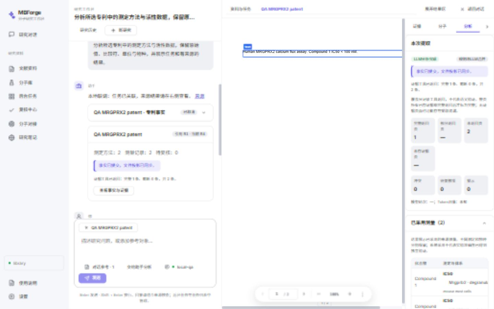
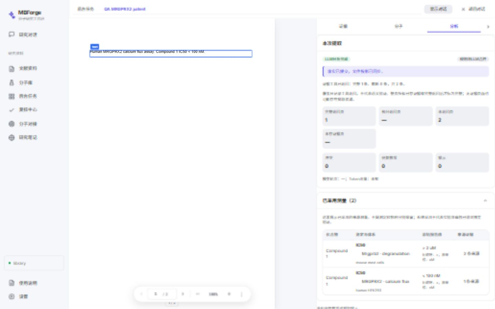

# 研究工作台前端验收记录

日期：2026-10-13。范围：[修改计划](../plan-patent-agent-harness.md)中的 U0、U1、P4 全部前端条目，以及用户授权补齐的必要研究会话/任务接口。状态：完成；P5 科学评估保留未完成。

## 交付

- 默认研究对话入口，资料、任务、复核和专业视图在同一工作台打开；结果区可展开，恢复对话不卸载会话。
- 文档、分子、任务上下文；文档/分子来源链接；分子详情复用已有组件。
- SQL 可见历史、Pi 持久化上下文、旧本机历史的幂等导入；刷新从研究历史打开会话，不重新执行旧动作。
- 显式授权本条消息启动所选文档的分析，服务端绑定资料库和凭据；请求幂等关联真实队列，准备中的导入可追加 Patent 阶段。
- 结构化 task/artifact 事件、实时任务卡与带 revision 的产物卡；旧消息正文保留，卡片展示当前结果。
- 有效测量表按原记录分别呈现，保留原始值、比较符和原单位；查看方法详情及测量/方法/条目的全部证据。
- 按证据 ID 在绑定文档内解析真实页码和 bbox，跨页来源定位后可正常手动翻页。
- 两方冲突比较、明确选择、过期决定处理、采用后刷新、重新开放已采用槽位；待复核值不进入有效测量。
- 真实证据工具覆盖与截断记录；SQL 快照及文件投影的 `current/pending/legacy` 观测状态。
- 普通聊天停止与后台任务取消分离；关闭专业视图、删除会话不隐式取消队列。

## 自动检查

| 检查 | 结果与范围 |
| --- | --- |
| 前端完整回归 | `npm --prefix frontend run test`：70 文件、305 项通过 |
| 最后布局改动 | App 现有 2 项定向检查通过；展开/恢复对话另做浏览器验收，无 CSS/文案测试 |
| 前端 Lint | `npm --prefix frontend run lint` 通过 |
| 前端生产构建 | `npm --prefix frontend run build` 通过 |
| Agent | `npm --prefix agent test`：9 项通过，包含真实 Pi JSONL 恢复、本地 HTTP provider、工具不重放及错误密钥过滤；脚本包含 TypeScript 编译 |
| 后端完整回归 | `uv run pytest tests/ -q`：882 项通过、1 项既有失败 |
| 后端失败 | `tests/unit/test_docking_engine.py::test_udp_command_and_pose_parsing`：Unix 无扩展脚本在 Windows 被直接执行，`WinError 193`；未修改对接代码 |
| Python 静态检查 | `uv run ruff check src tests` 与 `uv run ruff format src tests --check` 通过 |

Windows 检查使用已有 `.venv` / uv、工作区缓存和临时目录。新测试只保护已复现问题、公共存储/API 边界或关键工作流；旧的本机续聊拼装及其重复测试已删除，保留迁移读取保护。

## 浏览器及 HTTP 联调

使用 `127.0.0.1:5173` 的真实 React 页面、FastAPI 和 Node Pi 侧车，资料库及配置隔离在 `.tmp/research-ui-qa`；模型是 `127.0.0.1:18802` 的本地模拟服务。PDF、两种物种的测定、测量和冲突由夹具构造，未向真实 provider 发送用户资料。

隔离夹具禁用 worker，聊天分析真实写入队列但不执行模型提取；事实及冲突通过领域发布用例预置。它证明界面与接口接线，不证明专利识别或科学准确率。

| 场景 | 观察到的结果 |
| --- | --- |
| 初次进入 | `/agent` 显示研究对话，模型设置仅是设置入口 |
| 选文档 | 上下文出现文档引用和独立“交给助手分析”授权操作 |
| 启动分析 | 真实队列产生一个 Patent run，对话接收 task 引用并显示排队卡 |
| 产物引用 | 展示引用 R1 与当前 revision；任务卡不把旧 run 产物当作本次完成 |
| 刷新恢复 | SQL 历史恢复消息、文档上下文、task/artifact 引用；没有新增队列任务 |
| 复核 | 选择规则值后有效测量由 1 条变为 2 条，revision 递增，待复核数变为 0 |
| 决定撤销 | 公共 HTTP 用例重新开放槽位，恢复冲突和候选；再次选择后 R4 与计数同步 |
| 科学展示 | human MRGPRX2 与 mouse Mrgprb2 分行，`< 100 nM` 与 `> 2 uM` 保留 |
| 跨页来源 | 点击第 2 页证据 ID 后显示第 2 页和对应 SQL 原文；上一页操作可正常离开定位页 |
| 停止回答 | SQL 保留 stopped 状态和可见内容，原后台任务仍排队 |
| 取消后台任务 | 队列“取消”后原任务及对话任务卡变为已取消；会话与已发布结果保留 |
| 结果区展开 | 专业内容获得全宽空间，恢复对话后消息和引用仍在 |
| 窄窗口 | 800px 和默认窄视口下结果/对话分别展示，返回对话保留历史与引用 |

此前基础 UI 已验收中英文、浅/深主题、空库和模型未配置入口；本轮中文浏览器展示与英文组件回归覆盖新增状态，使用现有主题 token。未重做所有专业模块的视觉检查。

联调期间先前版本生成了一条队列状态未更新的隔离复核行。修复后只在该夹具内校正该行，再通过真实接口执行撤销和重新采用；不是生产资料库迁移或自动历史修复能力。

## 截图

下面均为隔离构造数据，无真实专利结论。

## 限制与后续

- 没有运行真实 provider 的专利提取，也没有人工金标准、规则/hybrid 正确率或召回率报告。P5 保留未完成，`patent_analysis.enabled` 不自动开启。
- 恢复的是可见历史和已有 Pi 上下文；不恢复断线时尚未完成的模型轮次。
- 工具覆盖表示证据实际返回及截断；不证明模型理解、语义准确或文档完整提取。
- 构建仍有既有 Vite 配置、3Dmol `eval` 与大包警告。改变视口时曾出现 ResizeObserver 通知警告，未阻断布局或关键交互；未扩展修复第三方渲染与全局提示策略。
- 验证服务均在验收结束后关闭，隔离夹具保留在忽略的临时目录。未重置工作区、未提交代码、未清理用户运行数据。
